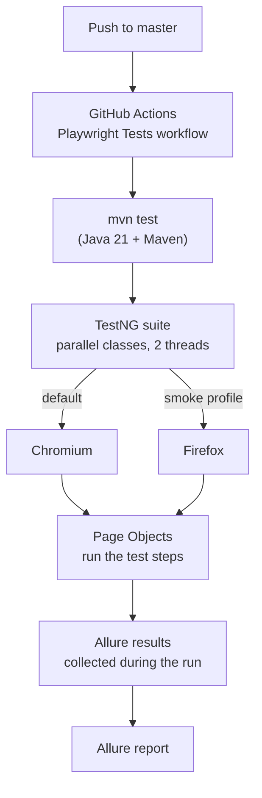

# Playwright Automation Framework: Java 21 | Playwright | TestNG | Allure

<div align="center">

### Pranab Sarkar
**SDET / Test Automation Engineer**

<a href="https://www.linkedin.com/in/pranabsarkar/" target="_blank">
  
</a>
&nbsp;
<a href="https://github.com/SarkarPranab" target="_blank">
  
</a>
&nbsp;
<a href="https://pranabsarkar.vercel.app/" target="_blank">
  
</a>

</div>

---

A test automation framework built from scratch with **Java 21**, **Microsoft Playwright** and **TestNG**, using the Page Object Model. Test results are collected with **Allure**, and every push is built and tested by **GitHub Actions**.

> **Application under test:** _add the site URL here_

---

## Features

- **Page Object Model** to keep tests clean and easy to maintain
- **Playwright for Java**: auto-waiting, fast and reliable browser automation
- **Cross-browser runs**: Chromium by default, Firefox through the `smoke` Maven profile
- **TestNG** with parallel execution (`parallel="classes"`, `thread-count="2"`) and group-based runs
- **Allure reporting** through the Allure TestNG integration
- **Data providers** through a shared `DataProviderUtil`
- **Logging** with Log4j2
- **CI with GitHub Actions**: the *Playwright Tests* workflow builds and runs the suite on every push to `master`

---

## Execution flow



---

## Tech stack

| Area | Tool | Version |
| --- | --- | --- |
| Language | Java | 21 |
| Browser automation | Playwright for Java | 1.63.0 |
| Test runner | TestNG | 7.12.0 |
| Reporting | Allure (TestNG integration, BOM) | 3.0.0 |
| JSON handling | Jayway JsonPath | 3.0.0 |
| Logging | Log4j2 | 2.24.1 |
| Build | Maven (Compiler 3.14.1, Surefire 3.6.0) | |
| CI | GitHub Actions | |

---

## Project structure

```
.
├── .github/workflows/      # GitHub Actions: Playwright Tests workflow
├── src/                    # Page objects, tests (tests.FrameworkTest), utilities
├── pom.xml                 # Dependencies, default build and `smoke` profile
└── testng.xml              # Suite: parallel classes, 2 threads
```

---

## Getting started

### Prerequisites

- JDK 21
- Maven 3.8 or later

Playwright downloads the browser binaries automatically on the first run, so no separate browser install is needed.

### Clone

```bash
git clone https://github.com/SarkarPranab/Playwright-Allure-CI-CD-Framework.git
cd Playwright-Allure-CI-CD-Framework
```

### Run the suite

```bash
# Default build: runs the suite from testng.xml in Chromium
mvn clean test

# Smoke profile: runs only tests in the "smoke" group, in Firefox
mvn clean test -Psmoke
```

### Maven profiles

| Profile | Browser | Tests |
| --- | --- | --- |
| default | Chromium | Suite defined in `testng.xml` |
| `smoke` | Firefox | TestNG group `smoke` |

---

## Allure report

Allure collects the results while the tests run. After a run, generate and open the report with the Allure command line tool (see the [Allure documentation](https://allurereport.org/docs/) for the install and the commands for your version).

---

## CI/CD (GitHub Actions)

Workflow: **Playwright Tests** in `.github/workflows/`

- Runs on every push to `master`
- Sets up Java 21, builds with Maven and runs the TestNG suite

---

## Adding a new test

1. Create a page object for the new screen.
2. Create a test class that uses it, and add `@Test` methods (add a group such as `smoke` if it belongs in the smoke run).
3. Register the class in `testng.xml`.
4. Run `mvn clean test` and check the Allure results.
